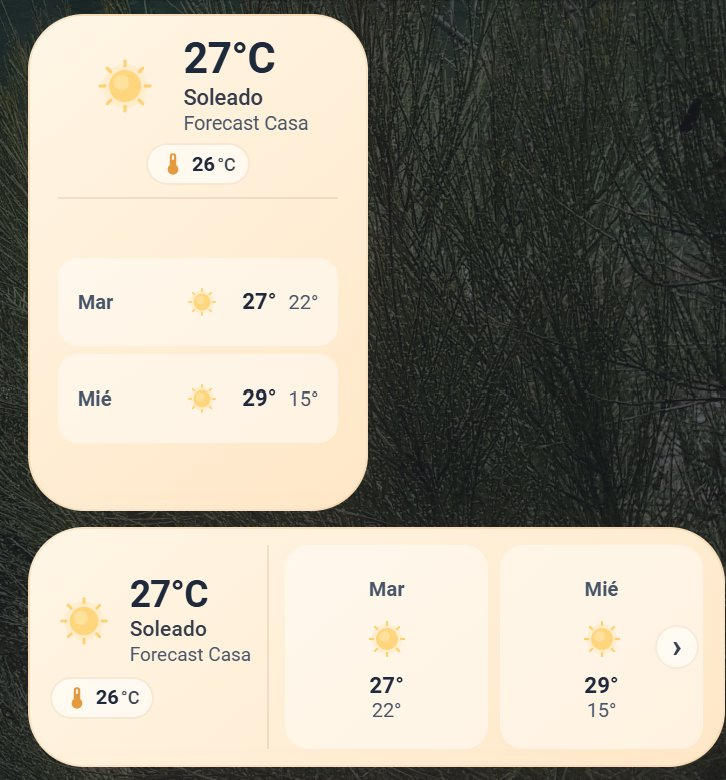
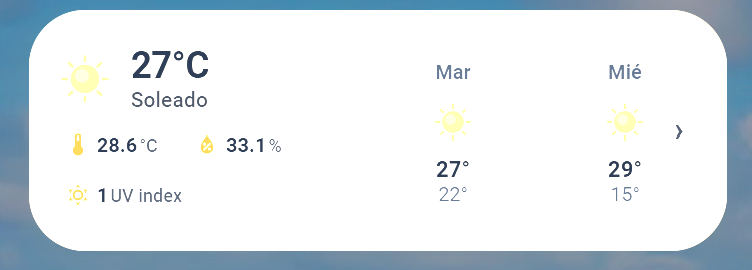

# Simple Pastel Weather Card

A minimalist, customizable Lovelace weather card for Home Assistant featuring custom pastel SVG icons, dynamic weather & day/night pastel backgrounds, a 100% transparent mode, support for custom sensors, and clean horizontal or vertical layouts built for Home Assistant **Sections**.

## Screenshots





## Features

- **Flexible data sources:** Use a `weather.*` entity (with optional sensor overrides for temperature or condition) or build a sensor-only weather card with no `weather.*` entity required.
- **3 customizable stat slots:** Assign any Home Assistant entity or attribute (humidity, wind, UV, feels-like, pressure, rain, etc.) with optional custom label, unit, icon, and isolated tap/double-tap/hold actions.
- **Explicit orientation & Sections-ready sizing:** Switch cleanly between `horizontal` and `vertical` layouts with zero clipped temperatures or truncated labels.
- **Adaptive daily & hourly forecast:** Uses Home Assistant's `weather/subscribe_forecast` WebSocket subscription and automatically adjusts visible forecast items to the card's width/height using `ResizeObserver`.
- **Custom minimalist pastel SVG icons:** Built-in day and night pastel icon set covering all standard Home Assistant weather conditions (zero external dependencies).
- **3 background modes:**
  - `dynamic`: Soft pastel gradient/surface adapting to the current weather condition and day/night cycle (`sun.sun`).
  - `theme`: Follows your active Home Assistant theme (`--ha-card-background`).
  - `transparent`: 100% transparent background with no border or shadow.
- **Full visual editor & Lovelace actions:** Built with `ha-form` and `ui_action` selectors for `tap_action`, `double_tap_action`, and `hold_action`.
- **Multilingual (10 languages):** `en`, `es`, `zh-Hans`, `de`, `it`, `fr`, `pt`, `ru`, `pl`, and `nl`.

---

## Sections Grid Sizing

Home Assistant **Sections** uses a 12-column grid (1 visual block = 3 columns):

| Mode | Forecast | Visual Units | Sections Columns × Rows | Minimum `getGridOptions` |
| :--- | :--- | :--- | :--- | :--- |
| **Horizontal** | Off | `2×1`, `4×1` | `6×1`, `12×1` | `min_columns: 6`, `min_rows: 1` |
| **Vertical** | Off | `1×2`, `1×4` | `3×2`, `3×4` | `min_columns: 3`, `min_rows: 2` |
| **Horizontal** | On | `4×2`+ | `12×2`+ | `min_columns: 12`, `min_rows: 2` |
| **Vertical** | On | `2×4`+ | `6×4`+ | `min_columns: 6`, `min_rows: 4` |

---

## Installation

### Manual Installation

1. Download `simple-pastel-weather-card.js` from the repository root (or `dist/simple-pastel-weather-card.js`).
2. Copy it to your Home Assistant `config/www/simple-pastel-weather-card.js` folder.
3. Add the resource in **Settings → Dashboards → Resources**:
   - URL: `/local/simple-pastel-weather-card.js`
   - Type: **JavaScript Module**

### HACS (Custom Repository)

1. Open **HACS → Frontend → Custom repositories**.
2. Add the repository URL with category **Dashboard**.
3. Install **Simple Pastel Weather Card** and reload your browser.

---

## Configuration

You can configure the card completely from the **Visual Editor**, or via YAML:

```yaml
type: custom:simple-pastel-weather-card
entity: weather.home
orientation: horizontal
background_mode: dynamic
show_icon: true
show_temperature: true
show_condition: true
show_name: true
show_stats: true
show_forecast: true
forecast_type: daily
stats:
  - entity: sensor.outdoor_humidity
    icon: mdi:water-percent
  - entity: sensor.wind_speed
    icon: mdi:weather-windy
  - entity: sensor.uv_index
    icon: mdi:white-balance-sunny
tap_action:
  action: more-info
```

### Main Options

| Key | Type | Default | Description |
| :--- | :--- | :--- | :--- |
| `entity` | `string` | — | Optional `weather.*` entity (required for forecasts). |
| `temperature_entity` | `string` | — | Optional sensor entity overriding main temperature (or primary temperature in sensor-only mode). |
| `temperature_attribute` | `string` | — | Optional attribute on `temperature_entity`. |
| `condition_entity` | `string` | — | Optional entity overriding the weather condition. |
| `name` | `string` | — | Custom title/location label (defaults to `friendly_name`). |
| `orientation` | `'horizontal' \| 'vertical'` | `'horizontal'` | Card layout orientation. |
| `background_mode` | `'dynamic' \| 'theme' \| 'transparent'` | `'dynamic'` | Background style (`dynamic`, Home Assistant `theme`, or 100% `transparent`). |
| `show_icon` | `boolean` | `true` | Show the pastel SVG weather icon. |
| `show_temperature` | `boolean` | `true` | Show the main temperature value. |
| `show_condition` | `boolean` | `true` | Show the localized weather condition label. |
| `show_name` | `boolean` | `true` | Show the card title / location name. |
| `show_stats` | `boolean` | `true` | Show the configured stat slots (`stats`). |
| `show_forecast` | `boolean` | `false` | Show the adaptive forecast section (requires `entity`). |
| `forecast_type` | `'daily' \| 'hourly'` | `'daily'` | Forecast granularity. |
| `forecast_items` | `number` | `auto` | Optional maximum cap on forecast items (leave empty for automatic sizing). |
| `stats` | `StatSlotConfig[]` | `[]` | Up to 3 custom sensor/attribute slots (`entity`, `attribute`, `label`, `icon`, `unit`, `tap_action`, `double_tap_action`, `hold_action`). |
| `tap_action` | `ActionConfig` | `{ action: 'more-info' }` | Global card tap action. |
| `double_tap_action` | `ActionConfig` | `{ action: 'none' }` | Global card double-tap action. |
| `hold_action` | `ActionConfig` | `{ action: 'none' }` | Global card hold action. |

---

## Development

```bash
npm install
npm run typecheck
npm run build
npm test
```
